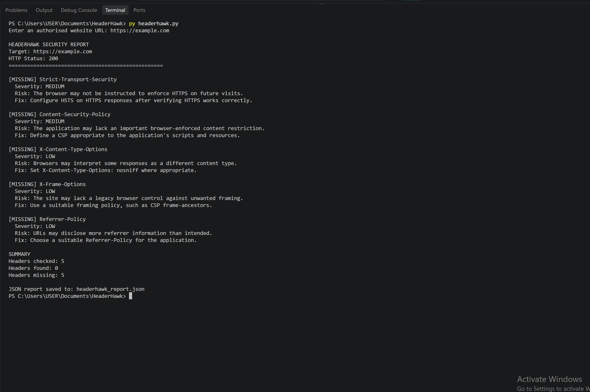

# HeaderHawk

**A Python-based HTTP Security Header Analyser by 404authority**

HeaderHawk is a lightweight security assessment tool that checks HTTP responses for five commonly recommended browser security headers. It identifies missing headers, explains potential risks, suggests remediation steps, and exports findings to a JSON report.

## Features

- Analyses HTTP and HTTPS responses.
- Checks five security-related HTTP headers.
- Reports missing headers with severity labels and remediation guidance.
- Displays a summary of findings in the terminal.
- Exports scan results as a JSON report.
- Validates URL schemes, hostnames, credentials, and ports.
- Includes automated unit tests for header analysis, URL validation, and network errors.

## Security Headers Checked

| Header | Purpose |
|---|---|
| `Strict-Transport-Security` | Helps browsers enforce HTTPS |
| `Content-Security-Policy` | Controls permitted content sources |
| `X-Content-Type-Options` | Helps prevent MIME-type sniffing |
| `X-Frame-Options` | Provides a legacy control against framing |
| `Referrer-Policy` | Controls referrer information sent by browsers |

## Project Author


**404authority** — Cybersecurity portfolio focused on Python security tools, web application security, and penetration testing.


## Installation


### Requirements

- Python 3.10 or later
- pip (Python package installer)
- Internet connection to install dependencies

### Setup

1. Clone the repository:

   ```bash
   git clone https://github.com/404authority/HeaderHawk.git
   ```

2. Enter the project directory:

   ```bash
   cd HeaderHawk
   ```

3. Install dependencies:

   ```bash
   py -m pip install -r requirements.txt
   ```


### Requirements

- Python 3.10 or later
- pip (Python package installer)

### Setup

1. Clone the repository:

   ```bash
   git clone https://github.com/404authority/HeaderHawk.git
   ```

2. Enter the project directory:

   ```bash
   cd HeaderHawk
   ```

3. Install the required dependency:

   ```bash
   py -m pip install -r requirements.txt
   ```

   On systems where `py` is unavailable, use `python -m pip install -r requirements.txt`.

## Usage

Run HeaderHawk from the project directory:

```bash
py headerhawk.py
```

Enter a website URL when prompted, for example:

```text
Enter an authorised website URL: https://example.com
```

HeaderHawk displays the HTTP response status, the status of each checked security header, and a summary of its findings.

The JSON report is saved as:

```text
headerhawk_report.json
```

The report file is generated locally and is excluded from Git tracking by `.gitignore`.

## Example Output

The following is an illustrative example of the terminal report. Results will vary depending on the target website's HTTP response.

```text
HEADERHAWK SECURITY REPORT
Target: https://example.com
HTTP Status: 200
==================================================

[FOUND] Strict-Transport-Security

[MISSING] Content-Security-Policy
  Severity: MEDIUM
  Risk: The application may lack an important browser-enforced content restriction.
  Fix: Define a CSP appropriate to the application's scripts and resources.

[MISSING] X-Content-Type-Options
  Severity: LOW
  Risk: Browsers may interpret some responses as a different content type.
  Fix: Set X-Content-Type-Options: nosniff where appropriate.

SUMMARY
Headers checked: 5
Headers found: 1
Headers missing: 4

JSON report saved to: headerhawk_report.json
```

*Note: This is illustrative output, not a record of the latest scan against the live website.*


### Live Terminal Screenshot




## Running the Tests

Run the automated test suite with:

```bash
py -m unittest -v
```

The tests cover security-header analysis, URL validation, simulated HTTP responses, and network connection failures.

## Limitations and Responsible Use

- HeaderHawk checks whether selected headers are present; it does not fully evaluate whether their values are secure.
- A missing header is an assessment finding, not proof that a website is exploitable.
- The current URL validation does not provide comprehensive protection against server-side request forgery (SSRF) or requests to internal network destinations.
- HTTP redirects are followed. Use only authorised targets and trusted environments.
- The tool is intended for learning and preliminary assessment, not as a replacement for a comprehensive security audit.

Only scan websites and systems you own or have explicit permission to assess.

## Licence

No open-source licence has been specified yet. Unless you add a licence, others generally do not receive explicit permission to redistribute or modify this project.

**404authority** — Cybersecurity and Python security tooling portfolio.